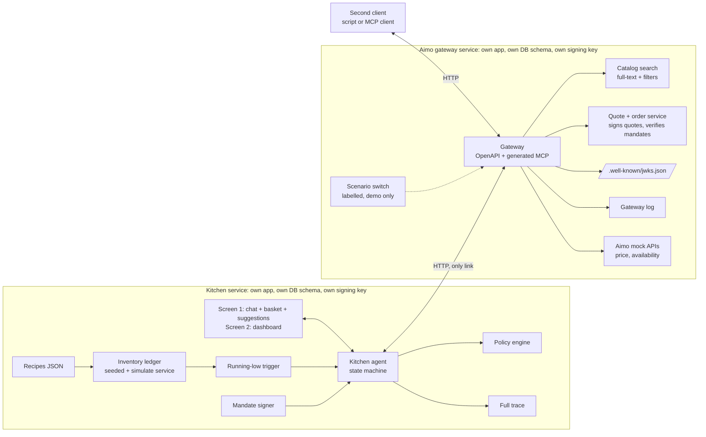

# Trusted Trade Agents: architecture

Valio Aimo challenge, Junction 2026. Stack: Python + FastAPI, Postgres (Aiven), React.

**Pitch in one line:** Aimo exposes an open, guarded interface that any agent can use. Our
kitchen agent uses it to turn what a kitchen needs into a correct, verified basket, and
nothing is ordered without a human's OK.

**The plan below is frozen** and was agreed before building started. The **Status** section is
the only part that changes. Every change to the code is one line in
[`CHANGES.md`](CHANGES.md); the shapes the services pass each other are in
[`CONTRACTS.md`](CONTRACTS.md).

---

## Status

Last updated **Saturday 14 November, 22:00 (hour 19)**. **243 tests passing**, and both services boot, all offline:
`cd Backend && python tests/test_units.py` and the rest.

| Block | Section | State |
|---|---|---|
| 1. Spine: request to a priced, editable basket | 8, 12 | **Done** |
| 2a. Quote and order | 4, 6 | **Done.** Confirm, approve, order. A refusal repairs the basket and suggests cover rather than ending in an error. |
| 2b. Mandate, signed approval, single-use quotes | 6, 7 | **Done.** All ten gateway checks; the kitchen issues and signs. |
| 3. Exceptions | 10 | **Done** except the scenario switch. Past cutoff, not deliverable, sales block, unknown size, price errors, stock changed between quote and order, expired quote, partial delivery split across products. |
| 4. Trace view | 12 | **Partly.** Every step carries `crossed_gateway`, but steps are returned per call and not stored, so the Activity tab has no history to query. |
| 5. Signed quotes | 6 | **Done.** Signed at confirm, Ed25519 JWS, single use, re-checked at order, tampering refused as a security event. |
| 6. Second client | 13 | **Not started.** Beat 5. |
| 7. Inventory and the running-low suggestion | 11 | **Done.** Append-only ledger, weekday forecast, shortfall trigger, reorder baskets. |
| Frontend | 12 | In progress. `Frontend/fixtures/sample_basket.json` is a real basket to build against. |
| Deployment | 13 | **Not started, and the largest unknown:** the mock API has never been called from a cloud host, and Aiven's free tier powers off when idle. |

**Who is building what:** Omer on the backend's kitchen side, one teammate on the frontend,
one on the gateway side, one on seed data, demo numbers and slides.

**Run it**

```
cd Backend
python scripts/sample_basket.py --order              # a sentence to an order, offline
python scripts/sample_basket.py --order --stock-moves 400   # the basket repairing itself
uvicorn gateway.main:app --reload --port 8001        # needs .env
uvicorn kitchen.main:app --reload --port 8002
```

**Known gaps**

1. **The audit log is built, both halves.** Gateway rows in `gateway.audit_log`
   (`GET /gateway/audit`), kitchen rows in `kitchen.audit_log` (`GET /api/audit`),
   joining on `quote_jti` and `order_id`. Tables applied to Aiven. The Activity tab
   still reads the browser's copy; pointing it at `/api/audit` is a frontend change.
2. **Nothing is deployed, and two things have never run live.** Both services now start
   and the whole kitchen-side HTTP path is verified (`scripts/smoke_test.py`), with one
   origin in front of all three via `deploy/Caddyfile`. Still unverified anywhere: the
   gateway's catalogue queries against Aiven, and a single live Gemini call. Both need a
   machine that can reach Aiven and Google - run `scripts/smoke_test.py` there and it
   says which of the two is wrong.
3. The chat reads every item in a message; the basket's own buttons still handle
   editing through `PATCH`. Needs one live Gemini run to confirm end to end.
   buttons handle editing through `PATCH`.
4. Sixteen of the seventeen seed products have never been priced against the live API, so
   their cut-offs are unknown. If cream's has passed, beat 3 drafts an empty basket.
   `python scripts/find_products.py --text cream --price 2026-11-17` settles it.
5. The scenario switch is not built. Real product ids cover every exception except
   `stock_changed`; `sample_basket.py --stock-moves` covers that in rehearsal but not on stage.

## 0. Decisions locked

| Decision | Why |
|---|---|
| **One spine:** request → basket → approval → order → trace. Everything else is built only after the spine works. | The working flow is 30% and most of the other criteria depend on it. |
| **The basket is the single object** for chat, suggestions and approvals. | One component, one data shape, one set of rules. |
| **Human in the loop by default.** Auto-approve exists as a policy option, off by default; the trust ladder is a pitch slide. | Aimo: people won't trust a fully autonomous agent. |
| **Two screens:** chat + basket + suggestions, and a dashboard. **The demo leads with the basket and the approval;** chat is one way to create a basket. | Aimo confirmed they want chat that produces a basket. Not every judge heard that, so we never look like a generic chatbot. |
| **"Model proposes, code decides, human approves."** The model never does arithmetic, never sets values in a basket, never places orders. | Guardrails are 20%. |
| **Units are defined before anyone codes,** with one tested conversion function used by both basket and quote. | The most likely bug to ship. |
| **Two real services, two database schemas, linked only over HTTP through the gateway.** Each side holds only its own private key. | Makes the data-ownership and signature claims true in the code. |
| **Trust in both directions, same library:** the kitchen signs a mandate and each human approval; Aimo signs a quote **at confirm time**. A quote can be ordered once. | The brief names the trust protocol; signing drafts would break on every edit. |
| **The gateway reveals as little as possible:** full / partial / none instead of stock counts; every agent is identified by its API key. | Aimo's own worry is exposing confidential data. |
| **The model never sees recipes, sales or stock.** | Kitchen data stays with the kitchen, whichever model host we use. |
| **Deterministic demo:** a clearly labelled scenario switch in our gateway, and a delivery date safely before cutoff. | We don't control the live mock on stage. |
| **No ML training, no vector search, no offers feed, no voice.** One proactive trigger: "running low". | Scope. |

---

## 1. Judging weights

| Criterion | Weight | Where we score it |
|---|---|---|
| Working end-to-end demo | 30% | Request → basket → signed quote → approval → order → trace, against the real mock API, reproducible |
| Solving the user's need | 20% | Correct units and quantities, structured claim filters, explained prices per litre/kg |
| Autonomy and controls | 20% | Policy engine, approval levels, signed mandate and signed human approval enforced by the gateway, single-use quotes, split trace |
| Robustness to exceptions | 15% | Sales block, partial, late date, cutoff, stock changed, expired quote, triggered on cue |
| Openness and path to production | 15% | OpenAPI + generated MCP, JWS/JWKS, a second client using the gateway live, stated assumptions |

---

## 2. Overview



- The kitchen agent is the only part of the kitchen service that calls the gateway. The running-low trigger hands its need to the agent, which builds the basket exactly like a chat request.
- The agent fetches Aimo's public key from `/.well-known/jwks.json` over HTTP. The kitchen's public key is registered with the gateway once, when the customer's agent is set up, and is never fetched from a URL inside a token. Neither service can read the other's private key or database.
- The second client uses the same gateway with no special access.

---

## 3. Units

Facts verified against the product file:

- `allowedLotSize` is **0.01 for 16,872 of 17,546 products**. It is only the smallest allowed step in sales units, not a case size.
- Case and pallet sizes are in `units[]` (`unitId`, `sizeInBaseUnits`), e.g. `KI` = 10 × `ST`.
- Sizes are in `synkkaData.unitConversions[]`. Each entry has a packaging level (`synkkaPackagingType`: `BASE_UNIT_OR_EACH`, `CASE`, `PALLET`) and `volume` / `netWeight`, each with its own unit. Two traps:
  - **The unit is not always litres or even a size.** `volume` holds `GRM`/`KGM` (a mass) far more often than `LTR`/`MLT`/`CLT`, and also `H87` (pieces), `MTR` (metres), `PTN`, `PR`. Among products with a `volume` and no `netWeight`: 211 are `H87`, 7 are `MTR`, 154 are a mass.
  - **The size is not always per base unit.** About 2,000 products have a usable size only on the `CASE` entry.
- Counted with both traps handled: **8,038 products have a usable size per base unit, 1,986 only per case** (10,024 in total; the earlier figure of 10,242 counted any `volume`/`netWeight` field). The other 7,522 need the product name ("10 l", "5 dl", "200 g") or have no size at all.
- In the milk category `10400`, only about half of the lactose-free products have a structured size. The rest need the name.
- Sales units are mostly `KI` (8,005) and `ST` (5,607).

**Worked example (real product):** Valio Eila® semi-skimmed milk drink 10 L Novobox, lactose-free (`463038`). Sales unit `KI`; 1 `KI` = 2 `ST`; 1 `ST` = 10 L. So 1 `KI` = 20 L, and 1,000 L = **50 KI**. Note: this product has **no structured volume** (its only `CASE` entry carries a gross weight); the 10 L comes from its name. It also has **no delivery reliability score**, while the 1 L packs `464201` and `464398` score 1.0 and have a structured 1 L size. Which product ranks first depends on the real prices (section 14).

**Every basket line and every quote line carries:**

| Field | Example (prices illustrative) |
|---|---|
| `need` | `{ "value": 1000, "unit": "L" }` |
| `base_unit`, `base_unit_size` | `"ST"`, `{ "value": 10, "unit": "L" }` |
| `size_source` | `"name"` (one of `structured`, `structured_case`, `name`, `unknown`) |
| `sales_unit`, `base_units_per_sales_unit` | `"KI"`, `2` |
| `quantity_sales_units` | `50` |
| `delivered_amount`, `overshoot` | `{ "value": 1000, "unit": "L" }`, `{ "value": 0, "unit": "L" }` |
| `price_per_sales_unit`, `price_unit` | `27.40`, `"KI"` |
| `price_per_litre` (or `price_per_kg`) | `1.37` (from `comparisonPrice` + `comparisonUnit`, or derived) |
| `line_net`, `line_vat`, `line_deposits`, `line_gross` | `1370.00`, computed in code |

Check: 50 KI × €27.40 = €1,370.00 net = 1,000 L × €1.37. Every number in the basket must pass a check like this.

**One conversion function with tests**, used by the basket and the quote:
`need_to_sales_units(product, need) → (quantity_sales_units, delivered_amount, overshoot)`. Rounds up to whole sales units and respects `allowedLotSize`. Tests on these real products at least:

| Product | Case it covers | Expected |
|---|---|---|
| `464201` (1 L UHT milk, sold per `ST`) | Structured litres per base unit | 1,000 L → 1,000 ST |
| `463038` (10 L Novobox, sold per `KI` of 2) | Size only in the name | 1,000 L → 50 KI |
| `460003` (40 g crisps, `KI` of 18 bags) | Size only at case level: `CASE` netWeight 720 g | 720 g per KI, i.e. 40 g per bag; never 720 g per bag |
| `460490` (table covers) | `volume` unit `H87` is pieces, not a size | No structured size; not convertible to L or kg |
| One product with `volume` in `GRM` | Mass stored in the volume field | Read as kilograms |
| `464179` (Arla 10 L Novobox, sold per `ST`) | Structured 10 L per base unit, no case unit | 1,000 L → 100 ST |
| `463335` (1 L milk with `KI` = 5 and `CS` = 20) | Two case-like units, but a base-level size exists | Base-level 1 L is used; the case units don't matter |
| One product with a size only at `CASE` level and both `KI` and `CS` units (12 exist) | Unclear which unit the `CASE` entry means | Not divided; falls through to name parsing |
| One multipack-style name (e.g. "4x1,5kg" or "200g/4pcs x8") | Name has a multiplier or two sizes | Not parsed; "size unknown, enter cases" |
| One product with no size anywhere | Unknown | "Size unknown, enter cases" |

**Size, in three steps:**
1. **Structured, reading the unit and the packaging level:**
   - Unit decides the meaning, **whichever field it is in**: `LTR`, `MLT`, `CLT` → litres; `GRM`, `KGM` → kilograms. Anything else (`H87`, `MTR`, `PTN`, `PR`, combined units) is not a size: ignore it and fall through.
   - A product can have both a litre size and a kilogram size (milk has `volume` 1 L and `netWeight` 1,031 g). Use the one that matches the need's unit. Never convert between litres and kilograms.
   - `BASE_UNIT_OR_EACH` entry → size per base unit (`size_source: structured`).
   - Only a `CASE` entry → that is the size of one case. Divide by the `KI` entry's `sizeInBaseUnits` from `units[]` to get the size per base unit (`size_source: structured_case`). If there is no `KI` entry (67 products), or the product has more than one case-like unit such as `KI` and `CS` (12 products), fall through to name parsing rather than guess which unit the `CASE` entry means.
2. Otherwise parsed from the FI/EN product name with one regular expression for ml, cl, dl, l, g, kg (`size_source: name`), shown in the basket as "size from product name". **Only when the name holds exactly one size and no multiplier.** Of the 5,432 products this step can parse, 1,168 have multipack-style names ("4x1,5kg", "200g/4pcs x8", "6PCS/20CL") and 238 hold two or more sizes; for those the parsed number is not the size of one base unit, so they fall through to step 3.
3. Otherwise `unknown`: excluded from automatic conversion and shown as "size unknown, enter quantity in cases". Never guessed.

**Variable-weight products** (`variableUnit` true, 632 products) are never auto-ordered; the basket flags them for a human.

**Money rules:** all spend limits (policy and mandate) apply to the **net goods value, excluding VAT and deposits**. The basket shows net, VAT, deposits and gross separately, and the rules tab says so. **Deposits:** the deposit material codes are not in the product file (0 of 506 products), so a deposit value is shown only if `/api/price` returns one; otherwise the basket shows the number of deposit units and "deposit charged separately".

---

## 4. Aimo gateway service

### Catalog search
- Load the product file into Postgres once. Postgres full-text search over FI/EN/SV names. No vector search.
- **Filter on structured fields, not names:**
  - `nutritionalClaim`: each value has an `id` (e.g. `FREE_FROM_LACTOSE`, 4,178 products; `FREE_FROM_GLUTEN`; `VEGAN`) and the same thing as a pair, `synkkaId` + `unit` (`LACTOSE` + `FREE_FROM`). Both forms are in the data. **Filter on `id`**; it is one exact string match.
  - `allergen` / `nonAllergen`
  - `packagingMarkedLabel`: e.g. `GOODS_FROM_FINLAND_BLUE_SWAN`
  - temperature, `countryOfOrigin`, volume
- **Category labels:** the 349 codes have no names. One model pass over sample product names per code produces a label table (e.g. `10400` → "milk drinks"); the important ones are checked by hand. Search can then filter by category. A category alone is not enough: `10400` holds 91 products including coffee milk, so the shortlist also applies the claim and a pack-size filter.

### Tools
FastAPI endpoints with an OpenAPI spec. The MCP layer is **generated** from them (e.g. `fastapi-mcp`; check in hour 1 that it works with our FastAPI version, and fall back to a thin hand-written MCP wrapper if not).

| Tool | Purpose |
|---|---|
| `search_products` | Text + structured filters → shortlist |
| `check_delivery` | "Can you deliver X by date Y?" → `can_fulfil: full / partial / none`, `fulfil_amount` **capped at the requested amount**, earliest date, cutoff. Plus price. |
| `create_quote` | Signed quote for the exact lines being confirmed (section 6) |
| `place_order` | Requires a valid quote JWS, a valid mandate JWS **and** a signed approval JWS for that quote; re-checks delivery; each quote can be ordered once; idempotency key for retries |
| `get_order` | Status and signed confirmation |

### What the gateway reveals
- **Never raw stock counts**, neither in `check_delivery` nor inside a signed quote. An agent learns whether its need can be met, not how much Aimo holds. Known limit, stated in the README: repeated queries with rising amounts can still probe stock; per-agent rate limits are the production answer.
- **Prices by identity:** each agent's API key maps to a customer. Every caller must have a key; there is no anonymous mode. The second client gets its own key and customer.

### Mock API client
- Auth via `X-API-Key`. Requests take `customer`, `requestedDate`, `products` (1–1,000 IDs).
- Called only for shortlisted products; cached; backs off on rate limits.
- Price fields used: `catalogPrice`, `listPrice`, `priceWithTax`, `comparisonPrice` + `comparisonUnit`, `tax`, `validFrom`/`validTo`, `netPriceFound`, `error`.
- Availability fields used: `salesBlock`, `closingTime`, `scheduleLines[]` (`availableAmount`, `availableDate`, `salesUnit`, `salesBlock`). `availableAmount` is used internally to compute `can_fulfil` and never passed on.

### Scenario switch (demo only, clearly labelled)
A server-side gateway setting, changed from a demo control page and never by a request header, that rewrites the mock's answer for named products: `sales_block`, `partial`, `late_date`, `past_cutoff`, `stock_changed`.
- Shown as a visible **DEMO SCENARIO** banner in the UI and recorded in the trace.
- Off by default: the real mock passes through untouched.
- Build `partial`, `sales_block` and `stock_changed` first; the other two only if time allows.
- Tonight, also try to find real product IDs that naturally return each case; use those where they exist.

### Demo controls (clearly labelled, demo customer only)
Each service exposes its own demo endpoints, and one small control page calls both. The gateway never reaches into the kitchen's database, and the kitchen, not the gateway, issues the mandate.
- **Demo reset:** the gateway endpoint clears the demo customer's orders, used quote IDs and weekly spend. The kitchen endpoint restores the seeded ledger **and the seeded on-order records** (beat 3 needs its "2 L on order"), and issues a fresh mandate. Without it, rehearsals use up the weekly limit: at the illustrative €1,370 net per run, the fourth run would exceed €5,000 and beat 1 would be rejected on stage. Run it before the video take and before the pitch.
- **Tamper with quote (demo):** a kitchen-side endpoint changes one price inside the quote the kitchen is holding and then tries to order, for beat 4. Nobody edits JSON on stage.

### Gateway log
Every query, quote, mandate check and order, with the agent's identity and any security event. This is everything Aimo sees.

---

## 5. Kitchen service

- **Kitchen agent:** the state machine in section 8; the only caller of the gateway.
- **Policy engine:** plain code. Returns `needs_approval(level, reasons[])` or `blocked(reason)`; `auto_ok` only if auto-approve is switched on. It runs twice: as a preview on every draft, so the chef sees "this will need a manager" before confirming, and as the binding decision on the signed quote.
- **Mandate signer:** section 7.
- **Recipes:** seeded JSON for one demo restaurant, 5–10 dishes, each ingredient mapped to a product ID with a quantity per portion in base units. No recipes tab.
- **Inventory ledger:** append-only movements (`delivery`, `sale`, `waste`, `count`); stock is the sum. Placing an order does **not** write to the ledger: it creates an **on-order record**. The `delivery` movement is written when the goods arrive (a "receive delivery" action, or automatically on the delivery date in the demo), and the on-order record is closed at the same moment. So an amount is never in both `stock` and `on_order`. **Seeded** with 4 weeks of synthetic history, labelled as synthetic. A single **"Simulate today's service"** button adds a day of dish sales instead of a sales-log screen.
- **Full trace:** every step, tool call, input, output and reason, written **from the first line of code** by a decorator on each tool call.

### Who sees what

| Data | Kitchen | Aimo |
|---|---|---|
| Recipes, dishes sold, stock, reasons that use them | ✓ | ✗ |
| Requests sent to the gateway, quotes, mandates, orders | ✓ | ✓ |
| Full agent trace | ✓ | ✗ |
| Gateway log | ✓ (own entries) | ✓ |

The Activity tab has a **"What Aimo sees"** toggle that filters the trace down to what crossed the gateway.

### The model
- Input: the request text plus candidate product data from the gateway. **Never recipes, sales or stock.**
- Output: structured, schema-validated (parsed need, explanation of the ranked choice, substitute proposal).
- Host: **team decision in hour 0.** Verda (EU, open weights) if a model good enough for parsing runs in time, pitched as the data-sovereignty choice. Otherwise Gemini, with the "request text only" rule stated in the pitch. (Not yet checked: which Verda models are available.)

---

## 6. Signed quotes (Aimo → kitchen)

**What a quote is:** Aimo's signed statement of price and delivery for the exact lines the chef is confirming.

**Wording:** the brief asks for ordering "based on fixed prices rather than a negotiated quote". Keep `quote` in the code, but in the UI and the pitch call it a **signed price confirmation** and say that the price is Aimo's fixed price, with no negotiation.

### When it is created
- **Drafts are not signed.** While the chef builds and edits a basket, lines use live prices and delivery answers from `check_delivery`. Edits are free.
- **`create_quote` runs when the chef presses Confirm.** The quote covers exactly the confirmed lines.
- The approver (chef or manager) approves **that exact quote**. `place_order` sends it back unchanged.
- **Any edit after a quote exists invalidates it.** The basket returns to draft and a new quote is created on the next Confirm.

### Payload

```json
{
  "iss": "https://gateway.aimo.example",
  "sub": "customer:123",
  "aud": "agent:kitchen-demo",
  "jti": "q_456",
  "iat": 1794650000,
  "exp": 1794657200,
  "requested_date": "2026-11-17",
  "lines": [
    {
      "product_id": "463038",
      "gtin": "<salesUnitGtin>",
      "quantity_sales_units": 50,
      "sales_unit": "KI",
      "delivered_amount": { "value": 1000, "unit": "L" },
      "price_per_sales_unit": 27.40,
      "price_per_litre": 1.37,
      "line_net": 1370.00,
      "currency": "EUR",
      "delivery": { "can_fulfil": "full", "fulfil_amount": 50, "delivery_date": "2026-11-17", "closing_time": "2026-11-16T14:00:00+02:00" },
      "origin": "fi",
      "size_source": "name",
      "claims": ["FREE_FROM_LACTOSE"],
      "labels": ["GOODS_FROM_FINLAND_BLUE_SWAN"]
    }
  ],
  "net_total": 1370.00,
  "checked_at": { "price": "2026-11-14T10:30:00+02:00", "delivery": "2026-11-14T10:30:00+02:00" }
}
```

Values are illustrative. Field names follow the data: lactose-free is a **nutritional claim**, the Finnish-origin mark is a **packaging label**. Neither is called a certificate.

- **Format:** compact JWS (RFC 7515), Ed25519 (`EdDSA`), header `{"alg":"EdDSA","kid":"aimo-2026-11"}`. Public keys at `/.well-known/jwks.json` (RFC 7517). Library: `joserfc` or `PyJWT[crypto]`.
- **Expiry:** `exp = min(earliest price validTo, earliest closing_time, now + 2 h)`. A quote can't outlive the order cutoff.

### What it fixes, and what it doesn't
- **Fixed until expiry:** the price.
- **Snapshot only:** delivery. The mock can't reserve stock, so the quote states what Aimo could deliver when it was checked. `place_order` re-checks; if delivery changed, the order is refused with `stock_changed`, the agent creates a new quote and the human approves again (same path as an expired quote).
- **What it proves:** Aimo made this statement, unaltered, at this time; Aimo can't deny it later and nobody in between can change it. It does not prove the statement is true. **Roadmap:** supplier- or certifier-signed W3C Verifiable Credentials for origin and labels.

### Verification
- The agent verifies signature, `aud`, and `exp` before showing the quote for approval; basket values come from the verified payload.
- The gateway verifies its own signature again at `place_order`.
- **A quote is single-use.** The gateway records the `jti` of every quote that has been ordered. A second `place_order` with the same quote is refused with `quote_already_used`, even with a new idempotency key. The idempotency key only makes a retry of the *same* request return the same order.
- **A failed signature is a security event, not a retry.** The order stops, the basket is marked `blocked: tampered_quote`, the event is written to both the trace and the gateway log, and the chef sees a clear warning. A new quote is only created when a human starts again.
- An expired quote is not a security event: re-quote, show any price difference, ask again.

---

## 7. Signed mandate (kitchen → Aimo)

**What a mandate is:** the kitchen's signed statement of what its agent is allowed to order through the gateway at all. It is the outer limit Aimo enforces; the kitchen's own approval levels (section 9) sit inside it.

### Payload

```json
{
  "iss": "https://kitchen.example/restaurant-demo",
  "sub": "agent:kitchen-demo",
  "aud": "https://gateway.aimo.example",
  "customer": "123",
  "jti": "m_789",
  "iat": 1794600000,
  "exp": 1795204800,
  "limits": {
    "max_net_per_order": 2000.00,
    "max_net_per_week": 5000.00,
    "currency": "EUR",
    "basis": "net goods value excluding VAT and deposits"
  },
  "allowed_categories": ["10400", "10401", "10411"],
  "approval_required": true
}
```

- **Signed with the same library and format** as quotes (JWS, Ed25519). The key id goes in the JWS header (`kid`), not the payload. The kitchen's public key is **registered with the gateway** for that customer when the agent is set up; the gateway never fetches a key from the `iss` URL in a token, because anyone could then mint a mandate with their own issuer.
- **Issued in the dashboard** (Agent rules tab) by the owner. Short expiry (e.g. 7 days). Early revocation is roadmap, not built.
- **Sent with every `place_order`.** The gateway checks, in order:
  1. signature against the public key registered for that customer, `aud`, `exp`
  2. `sub` matches the calling agent's identity, `customer` matches the quote's `sub`
  3. quote `net_total` ≤ `max_net_per_order`
  4. this order + this week's orders (from the gateway log) ≤ `max_net_per_week`
  5. every line's category is in `allowed_categories`
  6. `approval_required` is true → the order carries a **signed approval** (below): signature valid against the kitchen's registered public key, `aud` correct, and `quote_jti` equal to the `jti` of the quote being ordered.
- Any failed check → order rejected with the reason. A failed signature is logged as a security event.
- **Signed approval.** When a human presses Approve, the kitchen service signs an approval JWS with the same library and key as the mandate:

  ```json
  {
    "iss": "https://kitchen.example/restaurant-demo",
    "aud": "https://gateway.aimo.example",
    "jti": "a_321",
    "quote_jti": "q_456",
    "approver_role": "manager",
    "approved_at": 1794651000
  }
  ```

  - It is created only by the Approve action in the UI, never by the agent, so the agent can't make one up.
  - It names one quote, so it can't be reused for another, and that quote can only be ordered once.
  - **What it proves, and what it doesn't:** the kitchen's service signed an approval for exactly this quote. The gateway still can't see that a person pressed the button; that stays the kitchen's responsibility. Roadmap: approvals signed on the approver's own device (passkey).
- **No mandate → no order.** An agent without one can search and get quotes, but `place_order` is rejected. This is what the second client shows in the demo.

---

## 8. The kitchen agent

| Step | Done by | Detail |
|---|---|---|
| Parse the need | Model | "1,000 L lactose-free milk in 10 L packs by Tuesday" → product type, claims (`FREE_FROM_LACTOSE`), quantity + unit, optional pack size, optional brand, date. Schema-validated. |
| Check the date | Code | If the requested date is past the cutoff, propose the next possible date first |
| Shortlist | Code | Category label + claim + size filters (including the requested pack size and brand, if any) → 5–20 candidates |
| Convert units | Code | `need_to_sales_units()` per candidate; flag unknown sizes |
| Check delivery + price | Code | `check_delivery` for the shortlist |
| Rank | Code (model explains) | Meets constraints → net price per litre/kg → delivery reliability → carbon footprint. A missing reliability or carbon value is shown as "unknown" and never beats a known value in a tie-break |
| Handle exceptions | Code (model proposes substitutes) | Section 10 |
| Draft basket | Code | Lines with reasons and alternatives; editable; policy preview shown |
| Confirm → signed quote | Code | `create_quote` for the confirmed lines; verify JWS |
| Policy | Policy engine | Approval level + reasons, based on the quote |
| Approve → order → record | Human + code | Approve signs an approval for that quote; `place_order` with quote + mandate + signed approval; signed confirmation; **on-order record** (ledger `delivery` only on receipt); trace |

Rules: the model never does arithmetic or writes basket values; unknown data is shown as "unknown"; a substitute always has a reason and, outside a pre-approved list, needs a manager.

---

## 9. Guardrails and approval

Two layers, both enforced in code:

| Layer | Owner | What it decides |
|---|---|---|
| **Mandate** (section 7) | Kitchen signs, Aimo enforces | What the agent may order at all |
| **Approval policy** (below) | Kitchen | Who must approve each basket inside the mandate |

| Who approves | When |
|---|---|
| Chef | Net value up to €500, everything in the mandate, no flags |
| Manager | Above €500 net, weekly net budget above 80% used, quantity > 1.5× usual, substitute outside the pre-approved list, partial or late delivery accepted |
| Blocked | Outside the mandate, allergen hard rule broken, quote tampered or expired, unit size unknown |

**Trust ladder (pitch slide only):** drafts only → auto-approve routine reorders under €X → auto-approve within mandate. Each step is a policy setting the kitchen controls.

---

## 10. Exceptions

| Signal | Behaviour | Scenario switch |
|---|---|---|
| `salesBlock` | Drop; propose a ranked substitute | `sales_block` |
| `can_fulfil: partial` | Split across products or dates, or partial order; manager approval | `partial` |
| Delivery later than requested | Offer the later date or a substitute; never decide silently | `late_date` |
| Past `closingTime` | Next possible date, or substitute; flagged | `past_cutoff` |
| Delivery changed at order time | Order refused; new quote; approve again | `stock_changed` |
| Quote expired | New quote; show price differences; approve again | (short expiry in demo) |
| Quote signature fails | Security event; order stopped; human must restart | (tamper in demo) |
| Mandate check fails | Order rejected with reason | (second client) |
| Quote already ordered | Refused with `quote_already_used`; the existing order is shown; nothing is ordered twice | |
| Approval missing, invalid, or for a different quote | Order rejected; logged as a security event | |
| Price `error` / `netPriceFound` false | Excluded from ranking; "price on request" | |
| Size unknown | Excluded from auto-conversion; ask for cases | |

**Substitutes** (only 189 products list `substitutions`): same category label, same claims and allergen profile, convertible size, used in the same recipes. Ranked good / better / best, with the trade-off in one line.

---

## 11. Forecast and the one proactive trigger: "running low"

```
stock     = sum of ledger movements (base units); orders are not in the ledger until received
on_order  = sum of open on-order records (base units); closed when the delivery is received
window    = now → next delivery date still before cutoff, + 1 day buffer
usage     = Σ dishes: expected_portions(dish, day) × recipe_qty(dish, product), over the window
            expected_portions = 4-week average for that weekday (seeded history)

shortfall = usage + safety_buffer − stock − on_order
if shortfall > 0: hand the need to the agent → draft basket in the suggestions panel
```

- Subtracting `on_order` stops the agent ordering the same need every day. Because an order only becomes `stock` on receipt, nothing is counted twice.
- The suggestion's reason shows these numbers ("needs 14 L by Friday, 2 L in stock, 2 L on order → 10 L, order by 14:00 tomorrow").
- **ML roadmap (pitch only, opt-in):** kitchens that choose to share usage data with Aimo get better forecasts and priority stock allocation in return. Orders alone aren't usage, so this needs the kitchen's consent and its data. Models: gradient-boosted trees for regular items, Croston/TSB for slow movers, stockout flags for censored demand.

---

## 12. Screens

### Screen 1: Chat + basket + suggestions
- **Basket (centre):** each line shows need, quantity in sales units, delivered amount, price per sales unit and per litre/kg, delivery answer, reason, flags. Totals: net, VAT, deposits, gross. Status: draft → quoted "signed ✓" → pending approval → ordered. Edit, swap, remove, confirm.
- **Chat:** one way to create a basket.
- **Suggestions panel:** "running low" drafts, opening in the same basket. "Simulate today's service" button.

### Screen 2: Dashboard
1. **Approvals:** quoted baskets waiting for sign-off, with policy reasons.
2. **Agent rules:** approval limits, required claims, allergen blocks, pre-approved substitutes; **issue mandate**.
3. **Activity:** full trace, with the "What Aimo sees" toggle and security events highlighted.

Plus the labelled demo control page (scenario switch, demo reset, tamper button), which is not part of the product.

Only if ahead of schedule: an Inventory tab (stock, on order, movements). Cut: Recipes tab, Overview tab, voice, offers feed, hospital profile (slide only).

---

## 13. Build plan (as agreed at hour 0; the Status section says where it got to)

Hour 0 ≈ 03:00 Saturday, so the clock is already running. **This document is frozen at revision 7.2:** further changes go in as code or as one-line notes in the README, not as new revisions. **Feature freeze at hour 15.** Confirm the real submission deadline and demo length first, and shift every hour below to fit.

### Hour 0–1: contracts together, then one owner per task
The first 30 minutes are for the contracts. The remaining items are about three hours of work in total, so they run in parallel with one owner each and may spill into block 1.
- Agree and commit: units model (section 3), basket JSON, quote and mandate payloads, gateway OpenAPI contract.
- Write `need_to_sales_units()` with the tests listed in section 3.
- Decide the model host (Verda or Gemini).
- Check `fastapi-mcp` with our FastAPI version.
- **Run the milk request against the real mock** (demo-script owner, ~15 min): which lactose-free product in `10400` is cheapest per litre, its real price, and the real total for 1,000 L. Then:
  - write beat 1 of the demo script from those numbers
  - if the demo should show the 10 L Novobox, put the pack size in the request ("in 10 L packs") rather than hoping the ranking picks it. Two products match that wording: Valio `463038` (1,000 L = 50 KI) and Arla `464179` (1,000 L = 100 ST). Script the beat around whichever is cheaper, or name the brand ("1,000 L Valio lactose-free milk in 10 L packs by Tuesday")
  - check the real total is **above the €500 chef limit** (so the manager approval shows) and **below the mandate's €2,000 per-order limit** (so the order isn't rejected); adjust the two limits if not, and set the weekly limit to at least three runs
- Pick the demo delivery date (safely before cutoff) and look for real product IDs that trigger exceptions.
- Trace decorator in place before any tool is written.
- Deploy an empty version of both services to their final host, and keep deploying after every block. The first deployment must not happen after the freeze.

### Blocks, in priority order

Tracks A (gateway), B (agent) and C (frontend) work through blocks 1–6 in order. Track D owns data until the hour 7 checkpoint (product load, size parsing from names, category labels, conversion tests, scenario fixtures, seed data), then builds block 7.

| Block | Hours | Work | Done when |
|---|---|---|---|
| **1. Spine** | 1–7 | A: product load, full-text search, filters, category labels, mock client, `check_delivery`, OpenAPI + MCP. B: state machine, model parsing, unit conversion, ranking. C: basket component with every unit and price field; chat that fills it. | The demo request runs to an editable basket that matches the hand calculation from hour 0 (quantity, net/VAT/gross correct) |
| **2. Policy, mandate, order** | 7–10 | **2a, to hour 8.5:** quote + order service unsigned, policy engine, Approvals tab, so a request runs through to a placed order. **2b, to hour 10:** mandate signing (kitchen) and verification (gateway) with the JWS library; **signed approval bound to the quote**; **single-use quotes**; Agent rules tab as a plain form | Over-limit basket goes to manager approval; out-of-mandate order is rejected; an order without a valid approval is rejected; the same quote can't be ordered twice |
| **3. Exceptions** | 10–13 | Scenario switch; sales block, partial, late date, cutoff, stock changed, expired quote; substitute ranking | Each scenario runs on cue from a known product ID or the switch |
| **4. Trace view** | 13–13.5 | Activity tab with "What Aimo sees" toggle (rows already exist from hour 0) | Every demo run is readable end to end |
| **5. Signed quotes** | 13.5–14.5 | Sign at confirm, JWKS endpoint, verify in agent and gateway, invalidate on edit, `exp` with cutoff, security event, "Tamper with quote" button | An altered quote stops the order and logs a security event |
| **6. Second client** (track D) | 14–14.5 | ~30-line script or Claude Desktop config against the gateway | Client gets a quote; order is rejected without a mandate (and accepted with one) |
| **7. Inventory + running low** (track D) | 7–14 | Seed recipes and 4 weeks of sales; ledger; on-order records closed on receipt; "simulate today's service"; trigger; demo reset | One button press produces one correct draft basket |
| Buffer | 14.5–15 | Fix whatever is broken | |

### Checkpoints
- **Hour 7:** block 1 done. If not, everyone (including D) stops other work and fixes the spine.
- **Hour 8.5:** a request runs through to a placed order, unsigned (block 2a). This is the first moment the product works end to end; protect it before adding signatures.
- **Hour 10:** block 2 done. It is the tightest block, so the same rule applies: if it isn't done, everyone joins it before starting exceptions.
- **Hour 13:** exceptions run on cue.
- **Hour 15:** feature freeze. Anything unfinished is cut, not squeezed in.

**If behind schedule, cut in this order:** Inventory tab → second client as live MCP (keep the script) → block 7 shrinks to a pre-seeded suggestion → signed quotes shrink to the tamper check only → signed approval falls back to a logged approval record. The spine, mandate and exceptions are never cut.

### Sleep
3–4 hours each, in shifts so no track stops completely (e.g. two people sleep hours 8–12, two people hours 12–16). The block 1 owners don't sleep before the hour 7 checkpoint. Sleep removes roughly a quarter of the team's hours between hours 8 and 16, which is when blocks 2 to 6 run. The block hours above assume full staffing, so expect to use the cut order.

### After the freeze

| Hours | Work |
|---|---|
| 15–17 | Final deploy (both services have been live since hour 1; Aiven Postgres, two schemas, two DB users); run the full demo on the deployed version |
| 17–19 | Rehearse until the demo runs clean twice; record the submission video. **Checklist before every run, the video take and the pitch: press Demo reset, check the scenario switch is off, check the mandate is fresh.** |
| 19–21 | README with all assumptions; openness note (OpenAPI, MCP, JWS/JWKS, scenario switch disclosed); one note per partner tech challenge |
| 21–24 | Slides, pitch practice, buffer |

---

## 14. Demo script (5 beats, ~2 minutes)

1. **Request to order (45 s):** a basket for "1,000 L lactose-free milk in 10 L packs by Tuesday" (typed in chat; the brief's "by Monday" may already be past cutoff when we demo on Sunday, so we use the date picked in hour 0). Show the unit maths (50 KI = 1,000 L for the Novobox), price per litre, reasons. Confirm → "signed ✓". The total is over the chef limit → manager approves (the approval is signed for that quote) → order placed, mandate and approval checked by the gateway → trace.
2. **Exception (30 s):** scenario switch `partial` (banner visible) → agent splits across two products; chef swaps one line → basket back to draft → confirm → new signed quote, shown waiting for the manager. Stop there; the approval was already shown in beat 1.
3. **Proactive (20 s):** "Simulate today's service" → "cream: 2 L in stock, 2 L on order, needs 14 L by Friday → order 10 L before 14:00 tomorrow" → ready basket.
4. **Trust (15 s):** press **"Tamper with quote (demo)"** → one price changes → signature fails → order stopped, security event in the trace. Flip "What Aimo sees": requests, quotes, orders, no recipes or sales.
5. **Openness (10 s):** a second client connects to the same gateway, finds the milk, gets a signed quote, and its order is **rejected: no mandate**.

**The numbers in this script are placeholders until hour 0.** Prices in this document are illustrative; the product, price and total in beat 1 come from the real mock run in hour 0. If a 1 L pack wins without the pack-size wording, either keep "in 10 L packs" in the request or script the beat around the winner (1,000 ST of `464201`, say). With "in 10 L packs" the winner can still be the Arla Novobox `464179` (100 ST) instead of the Valio one (50 KI); add "Valio" to the request if the script needs 50 KI.

Before going on stage: Demo reset.

Slides only: trust ladder, hospital/school profile with allergen hard blocks, ML roadmap, Verifiable Credentials.

---

## 15. Pitch points

- **The wholesaler defines the agent interface on open standards** (OpenAPI, MCP, JWS/JWKS) before someone else's platform does. Shown with a second client live, not a spec slide.
- **Trust in both directions, one standard:** the kitchen signs what its agent may do and each human approval; Aimo signs what it states. Either side can verify the other with a standard library.
- **"Nothing is ordered without a human's OK" is checked on both sides:** Aimo refuses any order without the kitchen's signed approval for that exact quote, and a quote can be ordered once. Say it this way: Aimo verifies the kitchen's signature, not the person.
- **Honest about limits:** a quote fixes price, not stock; a signature proves who said it, not that it's true.
- **Reveals only what's needed:** full/partial/none instead of stock counts; customer prices only for identified agents.
- **Kitchen data stays in the kitchen:** separate services, the model never sees recipes or sales, and "What Aimo sees" shows it.
- **Every number explained:** units and prices computed in code, checkable line by line.
- **Path to production:** OAuth per agent, real stock reservation, POS integration, opt-in ML forecasting, Verifiable Credentials, more kitchen profiles.
- **Fixed prices, not negotiation:** say "signed price confirmation", matching the brief's "fixed prices rather than a negotiated quote".
- **Competitors:** say "third-party restaurant platforms"; name a company only if someone has verified the claim.

---

## 16. Data notes (verified against the product file)

| Fact | Consequence |
|---|---|
| 17,546 products; 349 category codes with no names | One model pass to label categories |
| `allowedLotSize` = 0.01 for 16,872 products | Not a case size; use `units[]` |
| Usable structured size per base unit for 8,038 products, per case only for 1,986 (10,024 in total); 7,522 need the name or have no size | Structured (unit and level checked), then name parsing (flagged), then "size unknown, enter cases" |
| `volume` units include `H87` (pieces), `MTR`, `PTN`, `PR`, and `GRM`/`KGM` (a mass) | Read the unit: litres, kilograms, or not a size |
| `463038` has no delivery reliability score; `464201` and `464398` (1 L packs) score 1.0 | Missing score shown as unknown; demo numbers taken from the real mock |
| Demo product `463038` has no structured volume | Its 10 L comes from the name; covered by a unit test |
| Of 5,432 name-parsable products, 1,168 have multipack-style names and 238 hold two or more sizes | Name parsing only for a single size with no multiplier |
| Of the 1,986 case-only products, 12 have both `KI` and `CS` units and 67 have no `KI` unit | Those fall through to name parsing |
| Two lactose-free 10 L products in `10400`: Valio `463038` (`KI` of 2, size from name) and Arla `464179` (`ST`, structured 10 L); neither has a reliability score | Either can win "in 10 L packs"; name the brand or script around the winner |
| 632 variable-weight products | Never auto-ordered |
| Deposit material codes absent from the product file (0 of 506) | Deposit value only if the price API returns it |
| Claim `id` `FREE_FROM_LACTOSE` on 4,178 products (also stored as `synkkaId` `LACTOSE` + `unit` `FREE_FROM`); also `FREE_FROM_GLUTEN`, `VEGAN` | Filter on the claim `id` in `nutritionalClaim`, not names |
| Category `10400` has 91 products, including coffee milk | Category + claim + pack size, not category alone |
| Labels such as `GOODS_FROM_FINLAND_BLUE_SWAN` in `packagingMarkedLabel` | Called labels, not certificates |
| Sales units mostly `KI` (8,005) and `ST` (5,607) | Conversion handles both |
| Only 189 products list substitutions | Own substitute logic |
| Plain search "lactose-free milk" returns chocolate and coffee milk | Category label + claim filters before ranking |
| No order history, customers, recipes or offers provided | Synthetic kitchen data, labelled as such; no offers feed |

---

## 17. Open questions for the mentors

- Is the order step ours to build? (The mock spec has no order endpoint.)
  **Answered:** yes, and an order never leaves our gateway. See section 18.
- Are there product IDs that reliably return a sales block or partial availability? Is a labelled scenario switch acceptable?
  **Answered:** the weekend data does not shift, so real ids cover every case but `stock_changed`.
- Is full/partial/none the right level of availability disclosure for external agents? (still open)
- JWS/JWKS for trust, or would they rather see Verifiable Credentials?
- MCP, OpenAPI or both for the agent interface? (still open)
- Does `/api/price` return deposit values, and how are variable-weight products priced?
  **Answered:** no deposit values appear in the price response.
- How long is the demo slot, and when exactly is the submission deadline?
  **Answered:** we present before Sunday 17:00, so beat 1 is a clean order.

---

---

## 18. What the live API actually does

Found by calling it, and confirmed by the Valio team where marked. This replaces the
hour 0 notes and the mentor answers, which were separate files.

### Access

- `GET /api/ping` with `X-API-Key`. **Cloudflare rejects a script-like user agent** with 403
  and "error code: 1010", so `gateway/aimo_client.py` sends a browser one. Without it the
  failure looks like a bad key. In PowerShell use `curl.exe`, not `curl`.
- **Every timestamp uses an offset with no colon** (`"+0200"`), which `datetime.fromisoformat`
  only accepts from **Python 3.11**. Everything goes through `shared/timeparse.py`; never call
  `fromisoformat` on a value from the API. Python 3.11+ for everyone and the deploy host.
- **Rate limits (Valio):** a 429 blocks us for 30 seconds. "A few hundred calls per minute is
  ok, over 10 seconds not ok." The client waits a 429 out, retries twice, honours
  `Retry-After`, spaces calls 0.25 s apart and caches each question.

### Prices

- `comparisonPrice` is **already per litre or kilogram**, and follows the customer price, not
  the list price (`464306`: catalogue 1.01, comparison 1.01, list 1.44). Rank on it.
- It is **rounded to cents, so never total with it**. The 10 L Novobox is EUR 1.57/L but the
  line total is 50 x EUR 31.31 = EUR 1,565.50, not 1,000 x 1.57.
- `catalogPrice / comparisonPrice` gives **the size of one sales unit**, which is a useful
  cross-check on the size rule and a last-resort fallback. More than 2% apart raises
  `size_disagrees_with_price` on the line.
- **`netPriceFound: false` is not an error.** It means no customer-specific price, so the
  catalogue price applies, for 24 of the 35 lactose-free milks. Exclude a product only when
  `error` is true or there is no `catalogPrice`.
- Only rank products whose `comparisonUnit` matches the need: 34 of the 35 report per `L`,
  one per `KG`.
- **No deposit values** appear anywhere in the price response.
- VAT is 13.5% on food. **VAT is computed once per line from the line's net value**, never by
  multiplying the API's rounded per-unit `valueWithTax`: that is EUR 3.65 out on 1,000 units.

### Availability

- **`availableAmount` at or above 999999 means availability is UNKNOWN**, not unlimited.
  Valio: "we do not know the availability and our current logic allows ordering any quantity.
  These values typically appear on terminal products that are not stocked by us." So any
  quantity may be ordered but nothing is confirmed: the answer carries
  `availability_known: false` and the line is flagged. Ten of the fourteen orderable milks are
  like this, so it is deliberately **not** an approval reason.
- **An empty `scheduleLines` list means not available** (Valio).
- `logisticModel` cannot replace the threshold: `Terminal` was unknown in all 20 cases, but
  `Stock` was unknown 10 times and a real count 4 times. It does say something else, though:
  **the 20 `Terminal` products are exactly the 20 past their cut-off**, because they are
  supplier-delivered.
- **`closingTime` is the cut-off for the related `availableDate`** (Valio), so when offering an
  alternative date the cut-off must be read from the schedule line chosen, not the product.
- **A passed cut-off does not change `can_fulfil`.** The Novobox answers `full` with
  `past_closing_time: true`, so anything reading the gateway must treat that flag as
  "cannot be ordered". The agent does, and it filters on the cut-off **before** ranking.
- **The mock data will not shift over the weekend** (Valio), so the recorded responses stay
  valid and real product ids cover every exception but `stock_changed`.

### Ordering

- **There is no order API and none is expected.** Valio: "it is enough that your solution can
  produce orders for human approval, they don't need to be sent anywhere." So our order step
  is the real thing for this challenge, not a stand-in, and nothing has to be undone after a
  demo run beyond our own reset.
- `allowedLotSize` **0.01 means 1** (Valio). A value below 1 means whole sales units.

### The demo's numbers

Only **14 of the 35 lactose-free milks are orderable**: 20 are past their cut-off, including
**both 10 L Novoboxes**, and one has no delivery schedule.

| | |
|---|---|
| Winner | `464306` Valio Hyvä suomalainen Arki Eila semi skimmed 1 l, lactose-free |
| Price | EUR 1.01 per L, the cheapest of the 35 |
| Quantity | 1,000 ST (1 L per ST) |
| **Net / VAT / gross** | **EUR 1,010.00** / 136.35 / 1,146.35 |
| Delivery | 2026-11-16, cut-off Sunday 17:00 |

The alternative on the line is `464401` at EUR 1.10/L (EUR 1,100.00), which shares the Sunday
cut-off. The Novobox appears as a second alternative **deliberately flagged
`past_closing_time`**, which shows the agent catching something a human reading the webshop
would miss. Every orderable milk is 1 L per unit, so the case arithmetic appears in beat 3
instead, where cream is ordered by the case.

